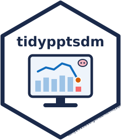

<!-- README.md is generated from README.Rmd. Please edit that file -->

```{r, include = FALSE}
knitr::opts_chunk$set(
  collapse = TRUE,
  comment = "#>",
  fig.path = "man/figures/README-",
  out.width = "100%"
)
```

# tidypptsdm <a href="https://tony2015116.github.io/tidypptsdm/"></a>

<!-- badges: start -->
[](https://github.com/tony2015116/tidypptsdm/actions/workflows/R-CMD-check.yaml)
<!-- badges: end -->

tidypptsdm watches the automatic feeding stations (NEDAP and FIRE) of a
pig performance test from day to day. It is the daily companion of
[tidypptsda](https://tony2015116.github.io/tidypptsda/), which reads and
prepares the data and computes ADG, ADFI and FCR at the end of the test.

- One call, `run_monitor()`, gives the daily tables of the last days per
  station, house, pig and hour, and the **alerts of the last day**:
  stations without visits, unidentified visits, drops in feed intake,
  pigs that did not visit or ate too little.
- Days without any visit are kept with zero counts, so a station that
  stopped recording or a pig that stopped eating is never missing from a
  table.
- `write_monitor_report()` writes an offline HTML report to browse
  station by station; `write_monitor_tables()` an Excel workbook with
  colour scales, or CSV files.
- `schedule_monitor()` runs it all every morning (Windows Task Scheduler
  or cron).
- Few dependencies: cli, data.table, ggplot2 and tidypptsda.

Documentation (in Chinese):
[快速入门](https://tony2015116.github.io/tidypptsdm/articles/tidypptsdm-zh.html),
[结果说明](https://tony2015116.github.io/tidypptsdm/articles/output-zh.html),
[定时运行](https://tony2015116.github.io/tidypptsdm/articles/schedule-zh.html),
[从 pptsdm 迁移](https://tony2015116.github.io/tidypptsdm/articles/migrate-zh.html).

## Installation

``` r
# install.packages("pak")
pak::pak("tony2015116/tidypptsdm")
```

## Example

```{r example}
library(tidypptsdm)

# A folder of exports works too: run_monitor("path/to/exports")
mon <- run_monitor(tidypptsda::nedap, days = 7)

# One row per station and day
head(mon$stations)

# Stations in rows, days in columns
wide_table(mon$stations, "feed_kg")

# Pigs that need a look on the last day
mon$pig_summary[status != "ok"]
```

```{r plot-intake, fig.height = 5}
plot_monitor(mon, "intake", locations = "101")$plot[[1]]
```

Write the report and the workbook:

``` r
write_monitor_report(mon, "monitor/2024-05-25", open = TRUE)
write_monitor_tables(mon, "monitor/2024-05-25")
```

Run it every morning at 7:30 on the export folder:

``` r
schedule_monitor("D:/nedap/exports", "D:/nedap/monitor", time = "07:30",
                 days = 7, house_width = 1)
```
