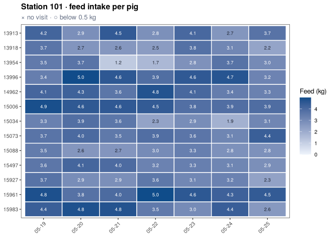

<!-- README.md is generated from README.Rmd. Please edit that file -->

# tidypptsdm <a href="https://tony2015116.github.io/tidypptsdm/"></a>

<!-- badges: start -->

[](https://github.com/tony2015116/tidypptsdm/actions/workflows/R-CMD-check.yaml)
<!-- badges: end -->

tidypptsdm watches the automatic feeding stations (NEDAP and FIRE) of a
pig performance test from day to day. It is the daily companion of
[tidypptsda](https://tony2015116.github.io/tidypptsda/), which reads and
prepares the data and computes ADG, ADFI and FCR at the end of the test.

- One call, `run_monitor()`, gives the daily tables of the last days per
  station, house, pig and hour, and the **alerts of the last day**:
  stations without visits, unidentified visits, drops in feed intake,
  pigs that did not visit or ate too little.
- Days without any visit are kept with zero counts, so a station that
  stopped recording or a pig that stopped eating is never missing from a
  table.
- `write_monitor_report()` writes an offline HTML report to browse
  station by station; `write_monitor_tables()` an Excel workbook with
  colour scales, or CSV files.
- `schedule_monitor()` runs it all every morning (Windows Task Scheduler
  or cron).
- Few dependencies: cli, data.table, ggplot2 and tidypptsda.

Documentation (in Chinese):
[快速入门](https://tony2015116.github.io/tidypptsdm/articles/tidypptsdm-zh.html),
[结果说明](https://tony2015116.github.io/tidypptsdm/articles/output-zh.html),
[定时运行](https://tony2015116.github.io/tidypptsdm/articles/schedule-zh.html),
[从 pptsdm
迁移](https://tony2015116.github.io/tidypptsdm/articles/migrate-zh.html).

## Installation

``` r
# install.packages("pak")
pak::pak("tony2015116/tidypptsdm")
```

## Example

``` r
library(tidypptsdm)

# A folder of exports works too: run_monitor("path/to/exports")
mon <- run_monitor(tidypptsda::nedap, days = 7)
#> 
#> ── Preparing NEDAP visits ──────────────────────────────────────────────────────
#>   Visits read                                31,863
#>   └ unidentified (kept, identified = FALSE)     211    0.7%
#>   └ body weight 0 (set to NA)                   391    1.2%
#> ℹ No pig was seen at more than one station
#> ✔ 30 pigs at 2 stations, 31,863 visits over 97 days 0.3s
#> ℹ No breed column. To use breed in the feed intake model and breed-specific limits, add it with `add_breed()`.
#> 
#> ── Monitoring NEDAP stations: 2024-05-19 to 2024-05-25 (7 days) ────────────────
#> ℹ 2 stations, 28 pigs; on 2024-05-25: 366 visits, 84.8 kg feed
#> ✔ No alerts

# One row per station and day
head(mon$stations)
#>    location       date n_pigs n_visits n_unidentified pct_unidentified
#> 1:      101 2024-05-19     13      192              2              1.0
#> 2:      101 2024-05-20     13      201              4              2.0
#> 3:      101 2024-05-21     13      228              2              0.9
#> 4:      101 2024-05-22     13      214              3              1.4
#> 5:      101 2024-05-23     13      234              1              0.4
#> 6:      101 2024-05-24     13      154              1              0.6
#>    occupation_h feed_kg feed_per_pig_kg weight_kg pct_weight_outlier
#> 1:        13.88  50.923           3.903    126.83                3.7
#> 2:        13.38  49.585           3.786    128.02                6.6
#> 3:        12.54  46.784           3.576    128.81                7.1
#> 4:        12.63  44.780           3.429    130.49                6.2
#> 5:        13.22  47.120           3.624    131.21                9.0
#> 6:        12.66  44.424           3.415    132.80                7.2

# Stations in rows, days in columns
wide_table(mon$stations, "feed_kg")
#>    location  05-19  05-20  05-21  05-22 05-23  05-24  05-25   total
#> 1:      101 50.923 49.585 46.784 44.780 47.12 44.424 42.030 325.646
#> 2:      102 58.752 56.385 47.664 53.857 50.52 55.163 42.784 365.125

# Pigs that need a look on the last day
mon$pig_summary[status != "ok"]
#> Empty data.table (0 rows and 11 cols): location,responder,days,no_visit_days,low_feed_days,mean_feed_kg...
```

``` r
plot_monitor(mon, "intake", locations = "101")$plot[[1]]
```



Write the report and the workbook:

``` r
write_monitor_report(mon, "monitor/2024-05-25", open = TRUE)
write_monitor_tables(mon, "monitor/2024-05-25")
```

Run it every morning at 7:30 on the export folder:

``` r
schedule_monitor("D:/nedap/exports", "D:/nedap/monitor", time = "07:30",
                 days = 7, house_width = 1)
```
